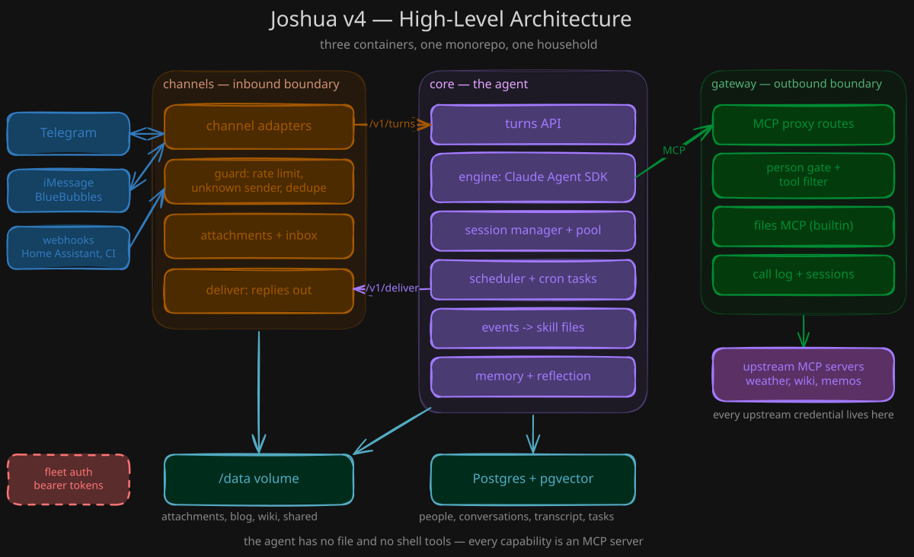

# Architecture

Joshua is three containers and one database. The three containers ship from one
repository and one `docker-compose.yml`. A fourth container, `assignments`, is
optional and off by default. The same code runs on one Docker host
and on Kubernetes.



```
                inbound trust boundary                 outbound trust boundary
Telegram ─┐                                                       ┌─ files MCP (wiki/journal/attachments)
iMessage ─┤   ┌──────────┐   POST /v1/turns   ┌──────────┐  MCP   │  weather, user-added MCPs …
Terminal ─┤──►│ channels │ ────────────────► │   core   │ ──────►│ gateway ├─ per-person upstreams
Webhooks ─┘   └──────────┘ ◄──────────────── └────┬─────┘        └─────────┘
                             POST /v1/deliver     │ Postgres + /data volume
```

## The three goals

Every design choice serves these goals, in this order:

1. **Security through reduced agency.** The agent has no file tools, no shell,
   and no direct web access. It reaches the world in three ways only: a reply
   through `channels`, an MCP tool call through `gateway`, and a question to the
   internet agent, which searches the open web and holds nothing else.
2. **Each task in the right container.** `channels` is the inbound trust
   boundary. `core` is the agent, the memory, and the scheduler. `gateway` is
   the outbound trust boundary and holds every upstream credential.
3. **Usable by one person, by a group, and by self-hosters.** One
   `joshua.yaml`, one compose file, `make up`.

## channels

`channels` talks to the messaging platforms. It receives a message from
Telegram, iMessage, the terminal, voice, or a webhook. It checks the sender against the
`people` and `groups` lists, applies the rate limit, and stores any attachment.
Then it posts one normalized turn to `core`. A reply comes back the same way:
`core` calls `channels`, and `channels` sends the text to the platform.

`channels` holds the platform credentials: the Telegram bot token and the
BlueBubbles password. It holds no upstream tool credential.

## core

`core` runs the agent. It keeps one session per conversation, composes the
system prompt, and calls the Claude Agent SDK. The SDK gets an empty tool list,
or only `ToolSearch` with [tool search](config.md#tool-search) on.
Every capability the agent has is an MCP server. Some run inside `core`
(memory search, reminders, adding a person, the subscription limits, looking
something up on the open web). The rest sit behind `gateway`.

The `internet` tool asks the internet agent, an ephemeral worker in `core`. The
worker gets one question and none of the conversation, and it holds the web
tools and nothing else. On the Anthropic server, a search runs on Anthropic's
side as `WebSearch`. On another server, a search goes through the gateway
route `POST /v1/search` to the SearXNG instance of `internet.search`, and with
no `internet.search` the worker has no search. Reading a page runs in `core`, only when
`internet.fetch.enabled` is on, and only for a page the worker was given.
[security.md](security.md) has the whole design.

`core` owns the database and the data volume. It indexes the volume for
retrieval, writes the nightly reflection, and runs the scheduler.

`core` holds the model credentials and the database password. For each model
call, it picks the server and the credential of that job from the
[`inference`](config.md#inference) section: by default the Claude
subscription. At start it removes the provider variables from its own
environment, so the CLI of a job gets the credential of that job and no other.
It reaches the model server, and, when fetch is on, the pages the internet
agent reads.

## gateway

`gateway` is one MCP endpoint for `core`. It maps each request to the speaker,
applies the speaker's tool policy, and proxies the call to
the upstream MCP server. It holds every upstream credential, so a compromised
session in `core` cannot read one.

The `files` MCP runs inside `gateway`. It is the only path that writes the
wiki and a person's journal, and it confines every path to its root. There is
one wiki. Everyone reads it, a member writes it, a guest reads it only.

## assignments

`assignments` is a fourth container, optional and off by default. It runs long
jobs for a member in the background: an assignment. Joshua starts one with the
`start_assignment` tool, through the gateway, and continues the conversation.
When the assignment ends or must stop, the container sends an event to
channels `POST /v1/events`, and core runs it as a turn in the person's
conversation.

A long job needs a checkout, a shell, and file tools. Core must not hold
them, because core holds every fleet token and the model credential. So the
work runs in its own container, which holds no model credential and no
upstream credential. It holds one fleet token of its own, the bearers of its
callers, and the database URL. It keeps its rows in the schema `assignments`
of the shared Postgres. It mounts `/data` read-only. On Kubernetes, a network
policy lets only the gateway reach it, and lets it reach only gateway,
channels, core, the database, DNS, and the git hosts you name.

Each assignment runs one Claude Agent SDK session in a scratch directory, in
slices. Before each slice, the container reads core's `GET /v1/limits`, and
the assignment stops at the ceiling that its spec sets on the subscription
windows. The session sends its model calls through core's forwarder, so the
model credential stays in core, and core gets one usage row for each slice.
[assignments.md](assignments.md) has the whole design.

## Who may call what

Every container loads the fleet tokens (`JOSHUA_TOKEN_<NAME>`). A caller sends
its own token as a bearer. The callee matches it and gets the caller's identity.
A missing or wrong token gets 401. An identity that is not on the route's list
gets 403.

| Route | Allowed callers |
|---|---|
| core `POST /v1/turns`, `POST /v1/turns/stream` | `channels` (and `laptop` for a `cli` handle) |
| core `POST /v1/memory/search` | `memory.search.allowed_callers` (default `viewer`, `mcp`) |
| core `GET /v1/usage` | `usage.allowed_callers` (default `viewer`) |
| core `POST /v1/usage` | `usage.writers` (default `assignments`), rows of kind `assignment` only |
| core `ANY /v1/model/{path}` | `inference.forwarder.allowed_callers` (default `assignments`), and any other token gets 401 |
| channels `POST /v1/deliver`, `GET /v1/channels/resolve` | `core` |
| channels `POST /v1/events` | `channels.webhooks.allowed_callers` (default `laptop`, `ci`) |
| channels `POST /v1/cli/turns/stream`, `GET /v1/cli/outbox` | `channels.webhooks.allowed_callers` |
| channels `POST /webhook/imessage/{secret}` | no bearer; the path secret is the credential |
| gateway MCP routes | `gateway.person_header_callers` (default `core`, `assignments`) |
| gateway `POST /v1/snapshots/{name}` | `core` only |
| `/admin/*` on every container | `ADMIN_CALLERS` (default `laptop`, `ci`) |
| `/healthz`, `/readyz` on every container | open, no secrets in the answer |
| core `GET /v1/limits` | open; percentages and reset times only |
| assignments `/mcp` | a bearer in `ASSIGNMENTS_TOKENS` (a person) or `ADDON_TOKEN` (read only); the gateway sends it |

`contracts.md` has the request and response shapes.

## The data volume

One volume mounts at `/data` in all three containers. Each container writes its
own part of it:

| Path | Writer |
|---|---|
| `people/<id>/attachments/`, `inbox/` | channels |
| `wiki/journal/YYYY/MM/DD/YYYY-MM-DD.md`, `wiki/people/<id>.md`, `wiki/people/everyone.md` | core, at the nightly run |
| `wiki/` | gateway, for a member |
| `wiki/journal/YYYY/MM/DD/<slug>.md` | gateway, for a member |
| `wiki/joshua-docs/` | core, at each start |

`data-layout.md` describes the tree. `memory.md` describes what `core` does with
it.

## One instance, one group of people

One instance serves one group of people. There is no multi-tenant mode. A
second group gets a second instance: the same three containers, a second
database, a second volume, and its own `joshua.yaml`. The two instances share
nothing.

Inside one instance, a person is a `member` or a `guest`. The role is a trust
tier. A guest has their own notes and journal, but does not see the shared
profile in the prompt and cannot add people. `security.md` states what each
role can reach.
